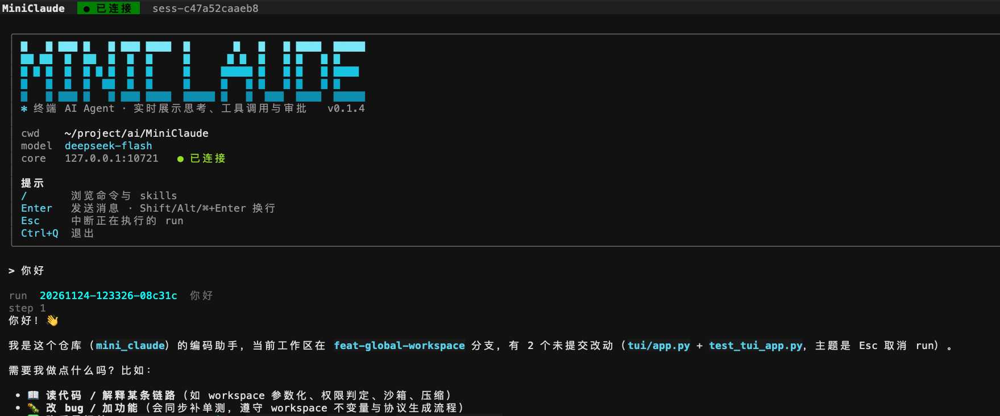
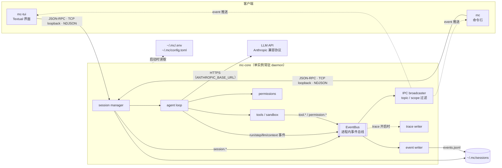

# MiniClaude



MiniClaude 是一个仿 Claude Code 的本地 AI Agent 系统，面向终端里的真实开发任务：阅读代码、改写文件、执行命令、排查故障，并以多轮对话持续推进。


## 总体架构

采用「单 daemon + 多客户端」架构：`mc-core` 常驻后台，负责会话管理、agent 循环与工具执行；`mc-tui`（Textual 界面）和 `mc`（命令行）通过本地 TCP 上的 JSON-RPC + NDJSON 接入，多个终端共享同一份会话与执行环境。

与直接调用模型 API 相比，MiniClaude 把执行链路做成可审批、可沙箱、可恢复、可观测的闭环：敏感工具调用先经过权限审批，命令在可选的系统级沙箱中运行；会话与每次 run 的事件全部持久化，支持恢复、回放和上下文压缩；进程内事件总线驱动 TUI 实时渲染，并提供 IPC/事件/LLM 三层 trace。



所有组件产出的事件都先发布到 `EventBus`，再由三类订阅者消费：`event writer` 落盘 `events.jsonl`、`IPC broadcaster` 按 topic/scope 推送给已订阅客户端、`trace writer`（可选）写入追踪日志。

## 特性

- **单实例 daemon**：常驻后台，多个 CLI/TUI 客户端共享；未运行时自动拉起。
- **workspace 隔离**：会话绑定启动目录，文件/命令工具、沙箱与权限审批均以其为根目录。
- **内置工具**：读写/编辑文件、glob、grep、git、bash，以及任务清单与子 agent等。
- **权限审批**：工具执行前按风险等级请求许可，支持本次/永久允许或拒绝。
- **系统级沙箱**：macOS `sandbox-exec` / Linux `bwrap`，可选禁网。
- **会话持久化**：对话与 run 事件落盘 `~/.mc/sessions`，可 `--resume` 继续、`--replay` 回放。
- **上下文压缩**：`/compact` 手动压缩，或按阈值自动触发。
- **Skills / Agents**：项目级、用户全局、内置三级优先级的 Markdown 技能与 TOML 角色。
- **MCP 支持**：通过 `config.toml` 接入 stdio / tcp 的 MCP 服务器。
- **Trace 调试**：IPC、事件、LLM 三层可筛选的 JSONL 追踪。

## 环境要求

| 依赖 | 版本 / 说明 |
|------|------|
| 操作系统 | macOS / Linux |
| Python | 3.12.x（由 uv 自动管理） |
| [uv](https://docs.astral.sh/uv/) | 任意较新版本 |
| 沙箱后端 | macOS 自带 `sandbox-exec`；Linux 需 `bwrap`（bubblewrap，`mode="off"` 可跳过） |

## 快速开始

```bash
# 安装
git clone https://github.com/tmnhs/MiniClaude.git && cd MiniClaude
make install  # 或 ./scripts/install.sh

# 配置：编辑 `~/.mc/.env`，`ANTHROPIC_API_KEY` 与 `ANTHROPIC_BASE_URL` 缺一不可
ANTHROPIC_API_KEY=sk-ant-...
ANTHROPIC_BASE_URL="https://api.deepseek.com/anthropic"

# 使用TUI
mc-tui            # 输入任务回车发送，Ctrl+Q 退出

#或使用CLI：
mc run --goal "统计 src 下的 Python 文件数量并写入 count.txt"
mc chat           # 多轮对话；权限提示用 y/a/n/d 回答
mc ping           # 验证连通：返回 pong
```


## 命令行

| 命令 | 说明 |
|------|------|
| `mc-tui [--resume SESSION_ID] ` | 启动 TUI；退出时打印可恢复的 session id |
| `mc run --goal TEXT` | 执行一次性 agent 任务 |
| `mc chat` | 终端多轮对话（流式输出 + 内联权限审批） |
| `mc ping` | 健康检查 |
| `mc core start/stop/restart/status` | 管理 daemon |
| `mc trace [RUN_ID] [--layer ipc\|event\|llm] [--follow] [--raw]` | 查看追踪日志 |
| `mc --version` | 版本号 |

## 文档

| 文档 | 内容 |
|------|------|
| [docs/installation.md](docs/installation.md) | 安装方式、升级与环境要求 |
| [docs/usage.md](docs/usage.md) | TUI/CLI 使用、会话恢复、权限、追踪 |
| [docs/configuration.md](docs/configuration.md) | 配置优先级、环境变量、config.toml、沙箱与 MCP |
| [docs/extending.md](docs/extending.md) | Skills、Agents、内置工具与子 agent |
| [docs/development.md](docs/development.md) | 开发命令、测试、目录结构 |
| [WIRE_PROTOCOL.md](WIRE_PROTOCOL.md) | 客户端/daemon 线协议（自动生成） |
